<div align="center">

# Inume Opencode Retro Themes

[English](README.md) · [Español](README.es.md) · [Português (Brasil)](README.pt-BR.md) · [Français](README.fr.md) · [Русский](README.ru.md) · **日本語** · [简体中文](README.zh-CN.md)

**ターミナル AI コーディングエージェント [OpenCode](https://opencode.ai/) のための、レトロなゲーム機とクラシックコンピューターを題材にした 13 個のテーマ。**

[](https://opencode.ai/)
[](#13-個のレトロテーマ)
[](https://github.com/Gianlucabernasconi/Inume-Opencode-Retro-Themes/actions/workflows/validate.yml)
[](LICENSE)

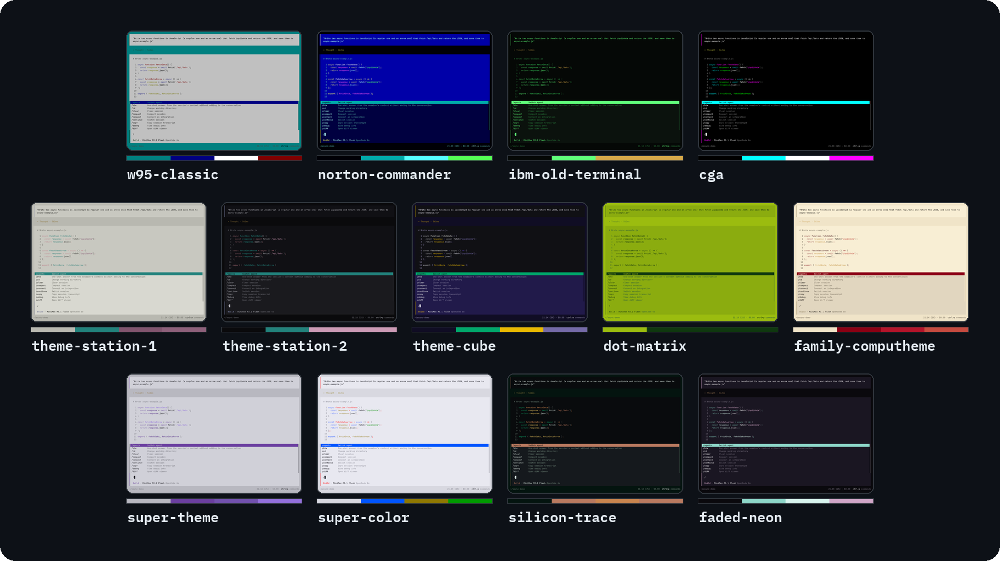

[テーマ](#13-個のレトロテーマ) · [ギャラリー](#テーマギャラリー) · [インストール](#opencode-にテーマをインストールする) · [有効化](#opencode-でテーマを有効化する)

</div>

---

**Inume Opencode Retro Themes** は、オープンソースのターミナル AI コーディングエージェント（TUI）である [OpenCode](https://opencode.ai/) 向けの、無料かつ MIT ライセンスの 13 個のテーマ集です。各テーマは、クラシックなハードウェアやソフトウェアの見た目を再現したもので、Windows 95、Norton Commander、IBM のリン光表示端末、CGA パレット、PlayStation 1 と 2、Nintendo GameCube、Game Boy、Famicom、SNES、PCB の回路基板、色あせたネオンを題材にしています。`~/.config/opencode/themes/` に配置する JSON 形式のテーマファイルとして提供されます。OpenCode 1.x と 2.x のダークモードとライトモードで動作し、最後の検証は OpenCode 2.0.21（2026 年 10 月）で行いました。

各テーマは push のたびに [`scripts/validate.js`](scripts/validate.js) で検証されます。OpenCode のテーマ用 `$schema` を使用していること、50 個のカラートークンすべてをダークとライトの両方のバリアント付きで定義していること（OpenCode 2 では、一部が欠けたテーマが警告なしで無視されます）、主要なテキストと背景の組み合わせが 1.8:1 以上のコントラスト比を保っていることが条件です。この比率は可読性の下限であり、WCAG のアクセシビリティ基準ではありません。

## 13 個のレトロテーマ

| テーマ | 着想元 | 雰囲気 |
| --- | --- | --- |
| [`w95-classic`](themes/w95-classic.json) | Windows 95 | ティールのデスクトップ、グレーのパネル、往年のデスクトップ UI |
| [`norton-commander`](themes/norton-commander.json) | Norton Commander | 青いファイルマネージャー風のターミナル、高コントラスト |
| [`ibm-old-terminal`](themes/ibm-old-terminal.json) | IBM PC terminal | 緑のリン光、黒い画面、コマンドライン中心 |
| [`cga`](themes/cga.json) | CGA パレット | 初期 PC のカラー、強いコントラスト、レトロなシアン |
| [`theme-station-1`](themes/theme-station-1.json) | PlayStation 1 | 淡いグレーの筐体、落ち着いた UI、クラシックなゲーム機の質感 |
| [`theme-station-2`](themes/theme-station-2.json) | PlayStation 2 | 深い黒、青いオーラ、暗いゲーム機の起動時のエネルギー |
| [`theme-cube`](themes/theme-cube.json) | Nintendo GameCube | パープルのハードウェア、遊び心のあるゲーム機らしさ |
| [`dot-matrix`](themes/dot-matrix.json) | Nintendo Game Boy | 黄緑の LCD、4 階調、携帯機のドットマトリクス画面 |
| [`family-computheme`](themes/family-computheme.json) | Nintendo Famicom | クリーム色と赤、古き良き日本のハードウェア |
| [`super-theme`](themes/super-theme.json) | Super Nintendo (SNES) | 柔らかなグレー、パープルのアクセント、クラシックな SNES |
| [`super-color`](themes/super-color.json) | SNES (Super Nintendo) multicolor | 明るいゲーム機のパレット、遊び心のある操作系 |
| [`silicon-trace`](themes/silicon-trace.json) | PCB circuits | チップの配線、緑の基板、ハードウェアラボ |
| [`faded-neon`](themes/faded-neon.json) | Worn neon | 微かなグロー、ピンクと緑のアクセント、深夜のターミナル |

> **固定パレットのテーマ。** `cga`、`dot-matrix`、`faded-neon`、`ibm-old-terminal`、`norton-commander`、`super-color`、`super-theme`、`w95-classic` は、実機と同じく、ライトモードとダークモードで同一のパレットを使用します。

---

## テーマギャラリー

テーマ名をクリックすると、その JSON ソースファイルが開きます。

### クラシックコンピューター

<table>
<tr>
<td width="50%" valign="top">

#### [`w95-classic`](themes/w95-classic.json)

Windows 95 のティール、グレーのウィンドウ枠、往年のデスクトップ UI のコントラスト。

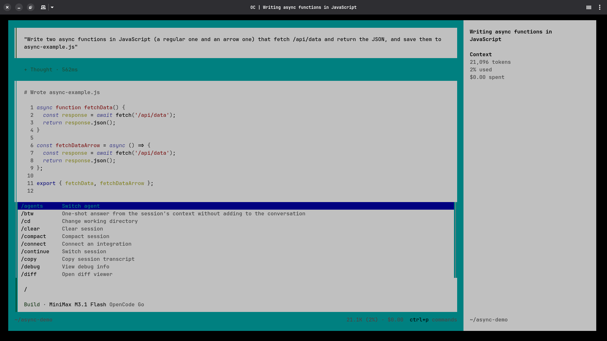

</td>
<td width="50%" valign="top">

#### [`norton-commander`](themes/norton-commander.json)

クラシックなファイルマネージャーの画面に着想を得た、青いターミナルパネル。

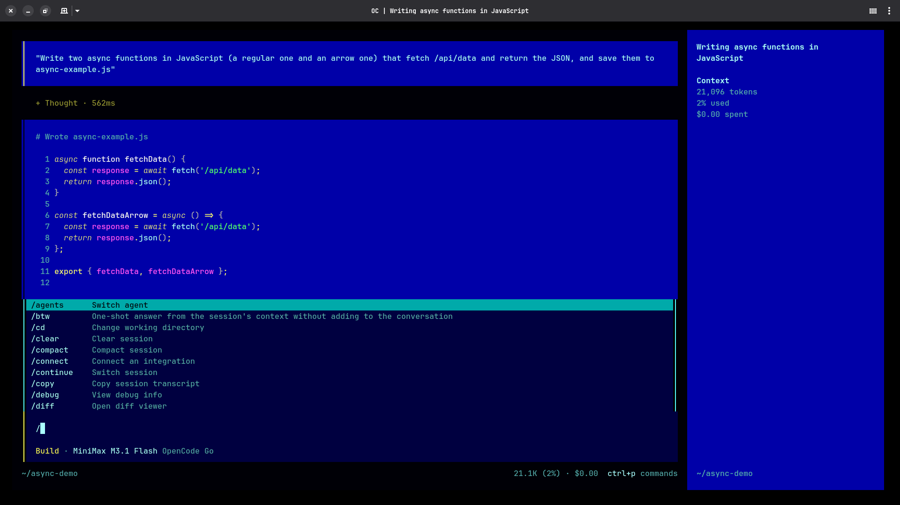

</td>
</tr>
<tr>
<td width="50%" valign="top">

#### [`ibm-old-terminal`](themes/ibm-old-terminal.json)

黒い画面、緑のリン光、IBM 端末のミニマルな雰囲気。

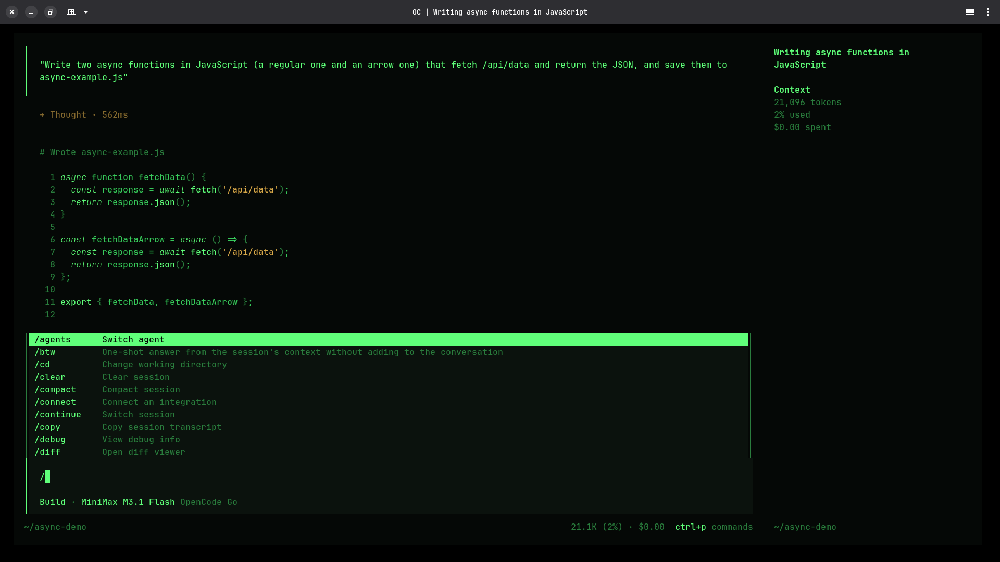

</td>
<td width="50%" valign="top">

#### [`cga`](themes/cga.json)

鮮やかなシアン、強いコントラスト、CGA 時代の鋭さを持つ初期 PC のカラーリング。

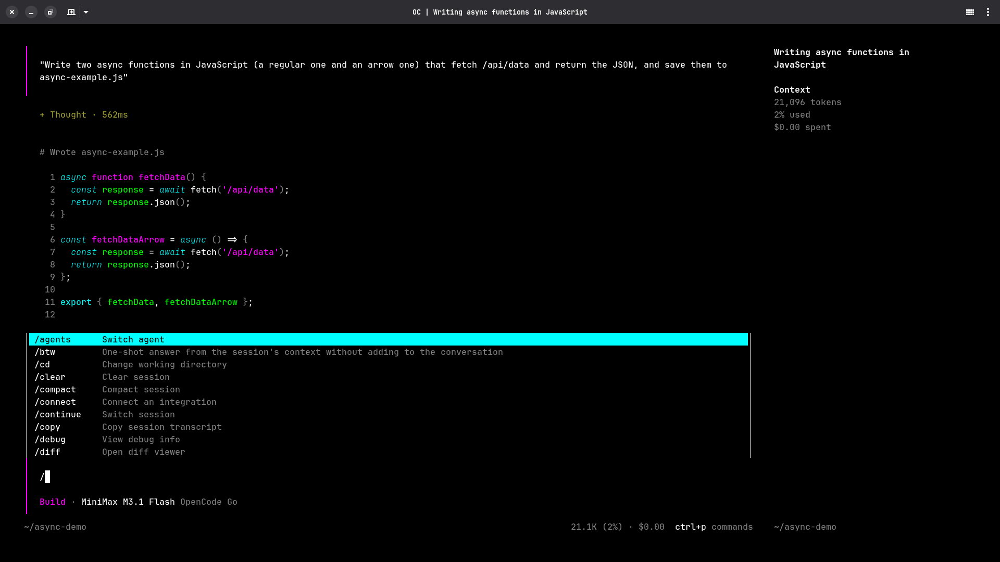

</td>
</tr>
</table>

---

### ゲーム機とビデオゲーム

<table>
<tr>
<td width="50%" valign="top">

#### [`theme-station-1`](themes/theme-station-1.json)

落ち着いたコントラストとクラシックなゲーム機の表面を持つ、柔らかな PlayStation グレー。

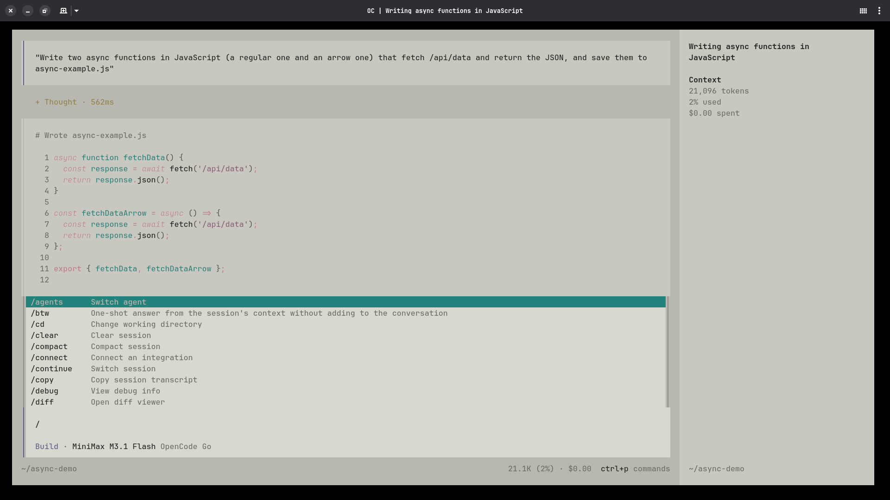

</td>
<td width="50%" valign="top">

#### [`theme-station-2`](themes/theme-station-2.json)

深い黒とエレクトリックブルーのハイライトを備えた、PS2 に着想を得た暗いパレット。

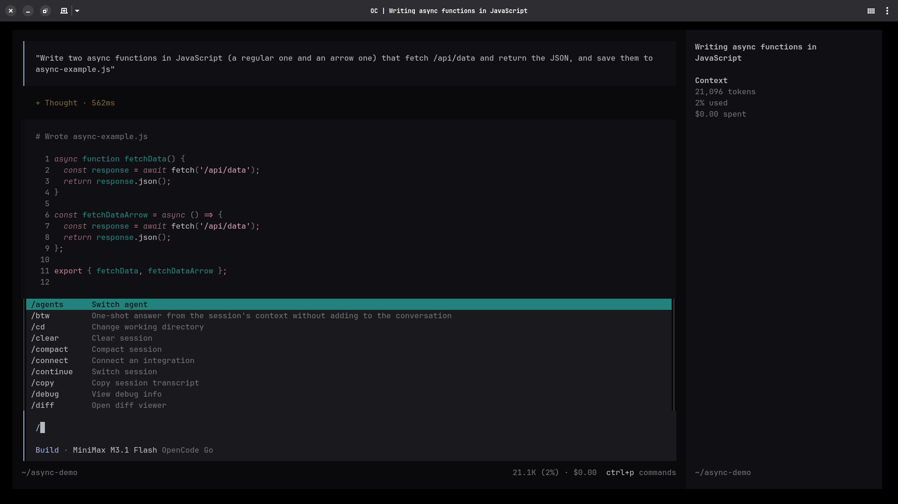

</td>
</tr>
<tr>
<td width="50%" valign="top">

#### [`theme-cube`](themes/theme-cube.json)

GameCube のパープルとゲーム機時代の彩度、遊び心のあるハードウェア感。

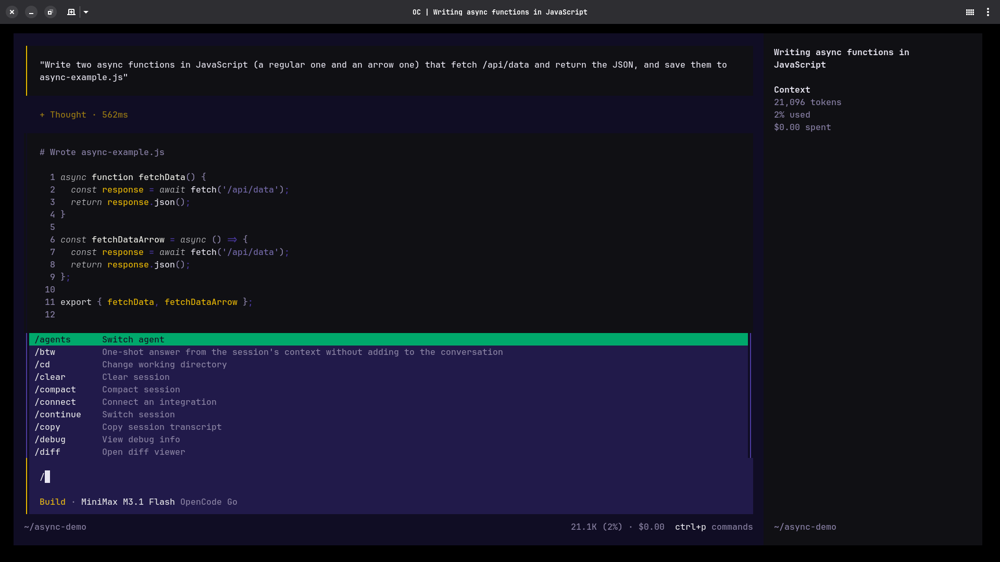

</td>
<td width="50%" valign="top">

#### [`dot-matrix`](themes/dot-matrix.json)

4 階調のドットマトリクスコントラストを持つ、Game Boy の黄緑色 LCD。

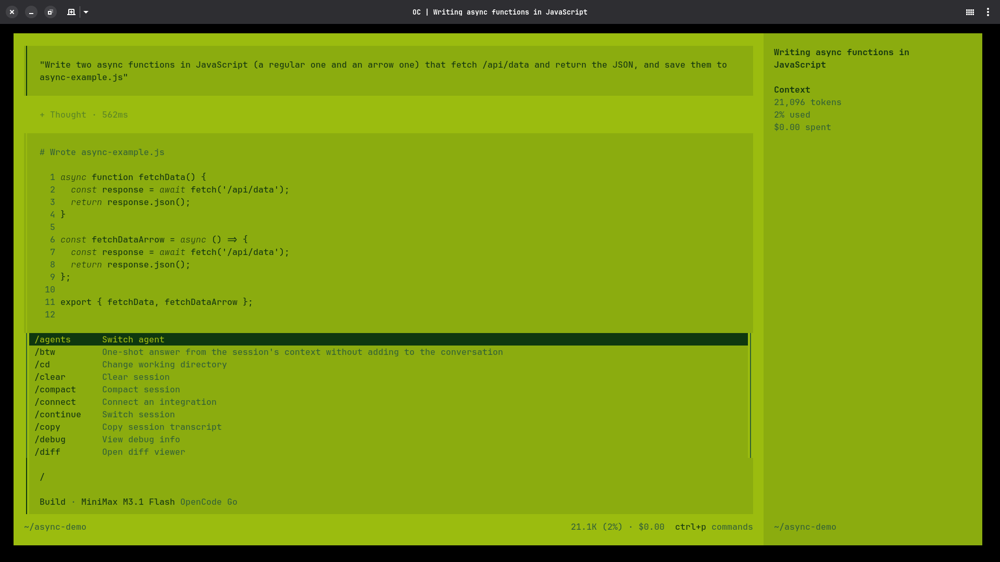

</td>
</tr>
<tr>
<td width="50%" valign="top">

#### [`family-computheme`](themes/family-computheme.json)

Famicom のクリーム色と赤を、温かみのある往年のゲーム機らしい見た目に調整。

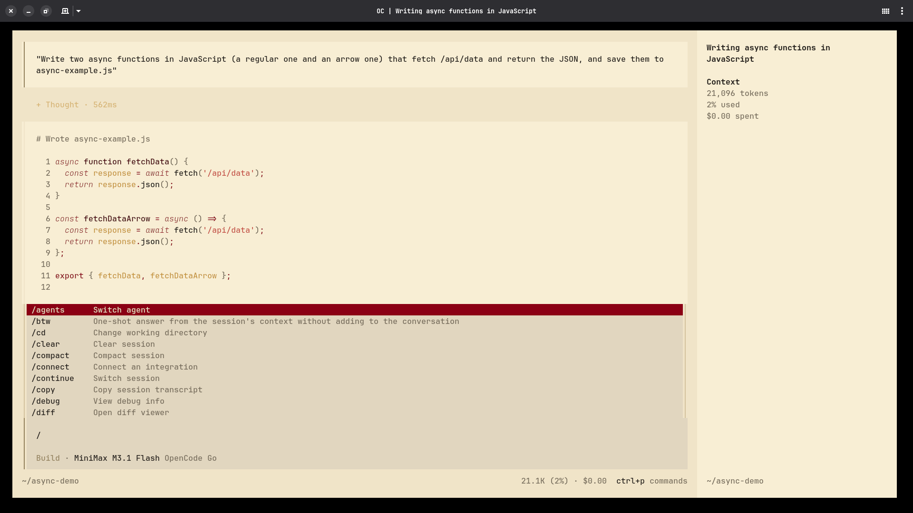

</td>
<td width="50%" valign="top">

#### [`super-theme`](themes/super-theme.json)

控えめなパープルのアクセントと読みやすいコントラストを持つ、クラシックな SNES グレー。

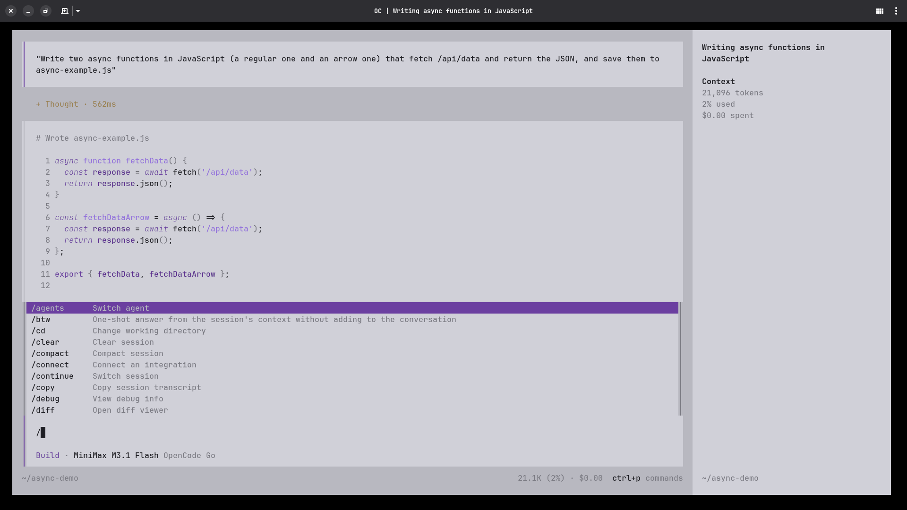

</td>
</tr>
<tr>
<td width="50%" valign="top">

#### [`super-color`](themes/super-color.json)

SNES の多色の操作系を、より明るいターミナルパレットとして表現したもの。

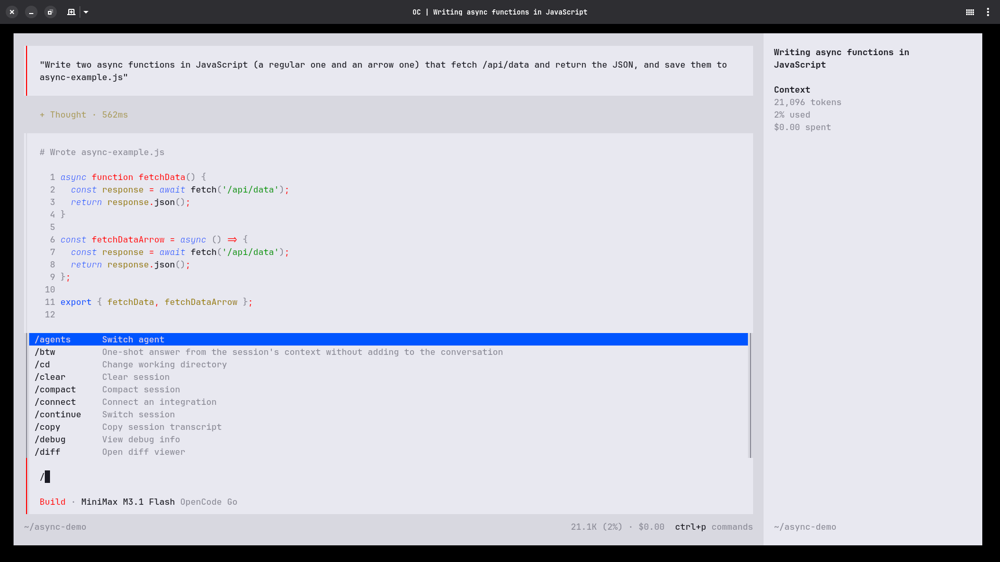

</td>
<td width="50%"></td>
</tr>
</table>

---

### 回路基板とネオン

<table>
<tr>
<td width="50%" valign="top">

#### [`silicon-trace`](themes/silicon-trace.json)

PCB に着想を得たターミナル向けの、回路基板の緑とハードウェアラボのコントラスト。

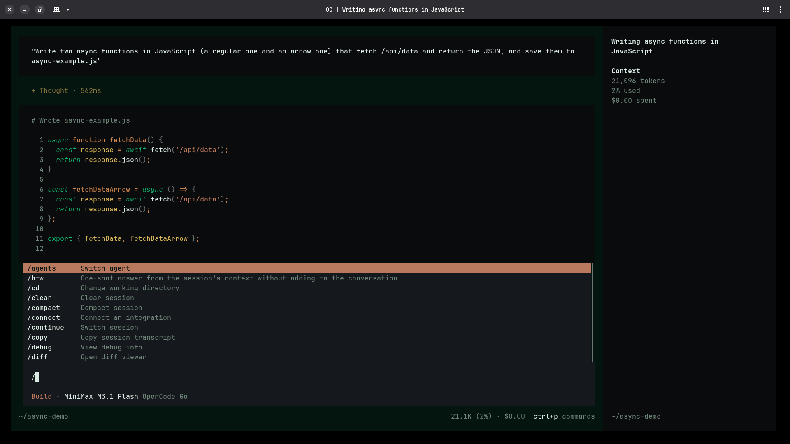

</td>
<td width="50%" valign="top">

#### [`faded-neon`](themes/faded-neon.json)

深夜の作業向けに、色あせたピンクと緑のアクセントでまとめた微かなネオンの輝き。

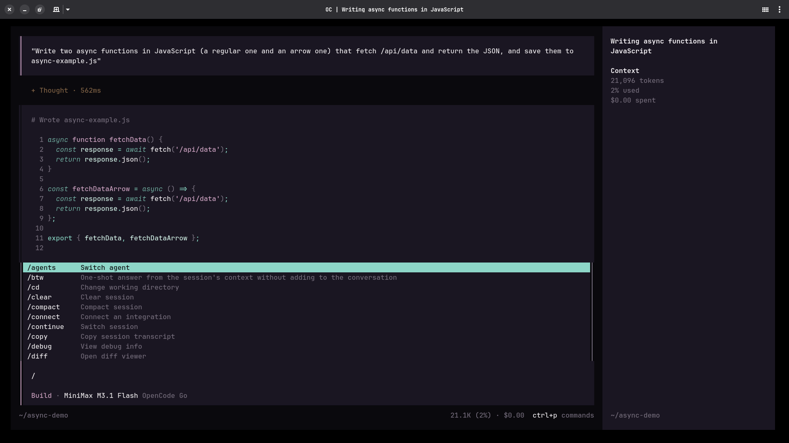

</td>
</tr>
</table>

---

## OpenCode にテーマをインストールする

### 方法A — ワンライナー（クローン不要）

1 つのテーマだけを OpenCode のテーマフォルダーに直接ダウンロードします。`theme-name` は上の表にある任意のテーマ名に置き換えてください。

```bash
mkdir -p ~/.config/opencode/themes
curl -fsSL https://raw.githubusercontent.com/Gianlucabernasconi/Inume-Opencode-Retro-Themes/main/themes/theme-name.json \
  -o ~/.config/opencode/themes/theme-name.json
```

### 方法B — インストールスクリプト

リポジトリをクローンし、インストーラーを実行してテーマを対話的に選ぶか、すべてインストールします。

```bash
git clone https://github.com/Gianlucabernasconi/Inume-Opencode-Retro-Themes.git
cd Inume-Opencode-Retro-Themes
./install.sh                    # 対話式の選択
./install.sh all                # すべてのテーマをインストール
./install.sh cga w95-classic    # 特定のテーマをインストール
./install.sh --project all      # 代わりに ./.opencode/themes にインストール
```

### OpenCode でテーマを有効化する

OpenCode 内で `/themes` を実行するとテーマセレクター「Switch theme」が開くので、一覧からテーマ名（`.json` を除いたファイル名）で選択します。

```text
/themes
```

または、`cli.json` で既定のテーマとして設定します（OpenCode 2.x）。

```json
{
  "$schema": "https://opencode.ai/v2/cli.json",
  "theme": { "name": "theme-name" }
}
```

OpenCode 1.x では、既定のテーマは代わりに `tui.json` に記述します。

```json
{
  "$schema": "https://opencode.ai/tui.json",
  "theme": "theme-name"
}
```

OpenCode 2.x は `tui.json` を `cli.json` へ移行するために一度だけ読み込みます。

OpenCode はカスタムテーマを `~/.config/opencode/themes/`、`<project-root>/.opencode/themes/`、`./.opencode/themes/` から読み込みます。後ろに挙げたディレクトリほど優先されます。

---

## ライセンス

[MIT](LICENSE) © 2026 [Gianluca Bernasconi](https://github.com/Gianlucabernasconi)

この日本語版は英語版 README（2026 年 10 月）の翻訳です。内容に相違がある場合は [README.md](README.md) を参照してください。